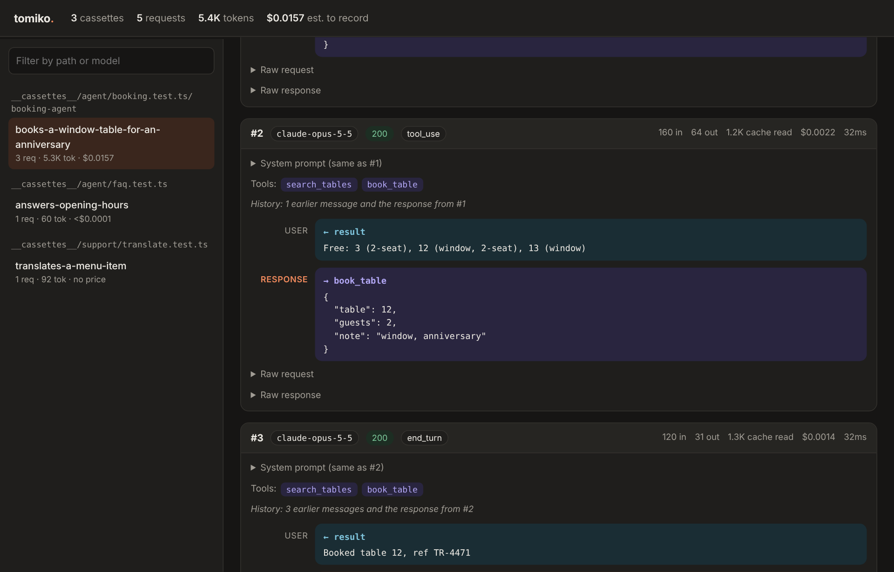

<a href="https://tomiko-m.github.io/tomiko-landing/">
  <picture>
    <source media="(prefers-color-scheme: dark)" srcset="./assets/banner-dark.svg">
    <source media="(prefers-color-scheme: light)" srcset="./assets/banner-light.svg">
    
  </picture>
</a>

<p align="center">
  <a href="https://tomiko-m.github.io/tomiko-landing/"><b>Website</b></a>
  &nbsp;·&nbsp;
  <a href="https://tomiko-m.github.io/tomiko-landing/docs.html"><b>Docs</b></a>
  &nbsp;·&nbsp;
  <a href="https://www.npmjs.com/package/tomiko"><b>npm</b></a>
  &nbsp;·&nbsp;
  <a href="https://github.com/Tomiko-M/tomiko"><b>Source</b></a>
  &nbsp;·&nbsp;
  <a href="https://github.com/Tomiko-M/tomiko/issues"><b>Issues</b></a>
</p>

<p align="center">
  <a href="https://www.npmjs.com/package/tomiko"></a>
  
  
  
</p>

<br>

<h3 align="center">Stop paying for the same tokens twice.</h3>

<p align="center">
  The first run records real LLM responses. Every run after replays them.<br>
  Agent tests that run <b>offline</b>, in <b>milliseconds</b>, for <b>zero tokens</b>, and give the same answer every time.
</p>

<p align="center">
  
</p>

<br>

## ◉&nbsp; Three lines to your first cassette

```ts
import { expect, test } from "vitest";
import { useCassette } from "tomiko/vitest";
import { agent } from "./agent";

test("books a table", async () => {
  await useCassette(async (c) => {
    const answer = await agent.run("Table for two at 7pm, by the window");

    expect(answer).toContain("Booked");
    expect(c).toHaveCalledTool("book_table", { guests: 2 });
    expect(c).toCostLessThan(0.05);
  });
});
```

| | | |
|:--|:--|:--|
| **01 · Install** | `npm i -D tomiko` | zero runtime dependencies |
| **02 · Record** | `ANTHROPIC_API_KEY=… npx vitest run` | real API, once |
| **03 · Commit** | `git add __cassettes__` | the recording lives next to the test |
| **04 · Replay** | forever | on CI, offline, for free |

<br>

## ◉&nbsp; HTTP recorders capture bytes. tomiko reads the conversation.

<table>
  <tr>
    <td width="33%" valign="top">
      <h4>🎞️&nbsp; Streams replay exactly</h4>
      SSE comes back chunk by chunk, so <code>stream()</code>, <code>finalMessage()</code> and streamed tool calls behave as they did live.
    </td>
    <td width="33%" valign="top">
      <h4>🧭&nbsp; Assert behaviour, not strings</h4>
      Which tools ran, with what arguments, in what order, how many requests it took, and what it cost.
    </td>
    <td width="33%" valign="top">
      <h4>💥&nbsp; Failures on demand</h4>
      Rate limits, overloads, dropped connections and slow responses, in each provider's real error format.
    </td>
  </tr>
  <tr>
    <td width="33%" valign="top">
      <h4>🔍&nbsp; Diffs you can read</h4>
      Change a prompt and the failure shows the changed words, not two blobs of JSON.
    </td>
    <td width="33%" valign="top">
      <h4>🔒&nbsp; Safe to commit</h4>
      API keys and request headers never touch disk. Secret query parameters are redacted.
    </td>
    <td width="33%" valign="top">
      <h4>💸&nbsp; Knows what it costs</h4>
      Usage is read from Anthropic and OpenAI responses. A model with no price is reported, never counted as free.
    </td>
  </tr>
</table>

<br>

## ◉&nbsp; Every cassette, as a conversation

System prompt, tool calls and results, the response, and the tokens, cost and time of each step.
One HTML file, no server, ready to attach to a CI run: `npx tomiko view`

<p align="center">
  
</p>

<br>

## ◉&nbsp; Works with

<p>
  
  
  
  
  
  
  
</p>

<br>

## ◉&nbsp; Repositories

| | |
|:--|:--|
| [**tomiko**](https://github.com/Tomiko-M/tomiko) | The library: record & replay LLM calls in your tests. |
| [**tomiko-landing**](https://github.com/Tomiko-M/tomiko-landing) | The website and documentation. |

<br>

<p align="center">
  <a href="https://tomiko-m.github.io/tomiko-landing/docs.html"><b>Read the docs →</b></a>
  &nbsp;&nbsp;·&nbsp;&nbsp;
  <a href="https://github.com/Tomiko-M/tomiko"><b>Star on GitHub ★</b></a>
</p>

<p align="center"><sub>MIT licensed · Deterministic agent tests in one install.</sub></p>
